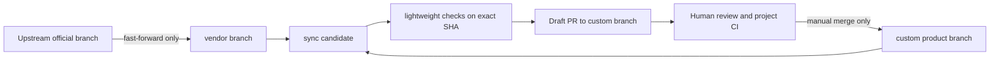

# راهنمای Git اکوسیستم Frappe Persian

## اصل مدیریت

هر فورک یک خط رسمی را دنبال می‌کند. `vendor/<branch>` آینهٔ فقط‌خواندنی از شاخهٔ هم‌نام سازنده است؛ `custom/<line-fa>` شاخهٔ محصول است؛ `sync/<branch>` نامزد به‌روزرسانی و مبنای Draft PR است. شاخهٔ Default فعلی هیچ مخزنی تغییر نمی‌کند. تغییرات Upstream فقط بعد از بررسی انسانی وارد شاخهٔ محصول می‌شوند.

## شاخه‌های هر مخزن

| مخزن | Upstream | Default فعلی | شاخه محصول | Mirror | نامزد |
|---|---|---|---|---|---|
| frappe-persian | frappe/frappe | develop | custom/develop-fa | vendor/develop | sync/develop |
| erpnext-persian | frappe/erpnext | develop | custom/develop-fa | vendor/develop | sync/develop |
| helpdesk-persian | frappe/helpdesk | develop | custom/develop-fa | vendor/develop | sync/develop-fa |
| crm-persian | frappe/crm | develop | custom/develop-fa | vendor/develop | sync/develop |
| insights-persian | frappe/insights | develop | custom/develop-fa | vendor/develop | sync/develop |
| raven-persian | frappe/raven | develop | custom/develop-fa | vendor/develop | sync/develop |
| frappe-ui-persian | frappe/frappe-ui | main | custom/main-fa | vendor/main | sync/main |
| hrms-persian | frappe/hrms | develop | custom/develop-fa | vendor/develop | sync/develop |

شاخه‌های نسخه‌ای مانند `version-15`، `version-16` و hotfixها شناسایی و دست‌نخورده می‌مانند. این خودکارسازی فعلاً فقط شاخهٔ Default Upstream هر پروژه را دنبال می‌کند. شاخه‌های تاریخی و کاری، از جمله شاخه‌های موجود Raven و همهٔ شاخه‌های Helpdesk، حذف یا بازنویسی نمی‌شوند.

شاخه‌های محصول هفت مخزن در این مرحله از SHA فعلی Default همان فورک ایجاد می‌شوند، چون شاخهٔ اختصاصی محصول از پیش وجود نداشت. این کار کد فارسی‌سازی ایجاد نمی‌کند و وجود ترجمهٔ اختصاصی در آن شاخه‌ها را اثبات نمی‌کند؛ پیش از اعلام آن‌ها به‌عنوان محصول فارسی باید محتوای هر مخزن جداگانه ممیزی شود.

## سازگاری نسخه‌ها

شاخهٔ `develop` به‌تنهایی تضمین نسخهٔ Frappe 17 نیست. شواهد متادیتای Upstream هنگام ممیزی: ERPNext develop اعلام می‌کند `frappe >=17.0.0-dev,<18.0.0`؛ CRM develop مقدار `>=16.0.0-dev,<=17.0.0-dev` دارد؛ Insights develop مقدار `>=15.0.0` و Raven develop مقدار `>=15.0.0,<=17.0.0-dev` دارد. خود Frappe develop در `pyproject.toml` Python `>=3.14,<3.15` را می‌خواهد. HRMS develop در خروجی ممیزی وابستگی صریح Frappe را نشان نداد؛ سازگاری دقیق باید از فایل‌های bench/dependency همان SHA تعیین شود. `frappe-ui` یک کتابخانهٔ frontend است و شاخهٔ `main` آن نسخهٔ پکیج مستقل `1.0.0` را نشان می‌دهد. این‌ها شواهد شاخه‌های Upstream هستند، نه تضمین آزموده‌شده برای SHAهای فورک. هیچ شاخه یا وابستگی‌ای در این مأموریت ارتقا داده نمی‌شود.

## زمان‌بندی و مجوزها

Workflow `Safe upstream sync` روزانه ساعت 05:23 UTC اجرا می‌شود و `workflow_dispatch` هم دارد. فقط `vendor` با Fast-forward به‌روزرسانی می‌شود. Job همگام‌سازی حداقل مجوز لازم برای نوشتن محتوا و ساخت PR را می‌گیرد؛ Jobهای دیگر فقط خواندنی هستند. هیچ Auto Merge یا Auto Deploy وجود ندارد.

با `GITHUB_TOKEN`، رویدادهای حاصل از Push/ساخت PR به‌طور عمومی زنجیرهٔ Workflowها را اجرا نمی‌کنند؛ بعضی رویدادهای Pull Request در حالت نیازمند تأیید قرار می‌گیرند. برای جلوگیری از وابستگی به GitHub App، بررسی سبک روی همان SHA داخل اجرای Sync و پیش از Push/ساخت PR انجام می‌شود. Push انسانی به شاخهٔ `sync/*` نیز اعتبارسنجی جداگانه دارد. این اعتبارسنجی جایگزین تست کامل پروژه، Build، یا بررسی کاربر نیست.

## اجرای دستی و رسیدگی به تعارض

از تب Actions، Workflow `Safe upstream sync` و `Run workflow` را روی Default Branch اجرا کن. اگر upstream تغییری نداشته باشد، هیچ تست، Push یا PR جدیدی اجرا نمی‌شود. اگر Mirror جلوتر/واگرا باشد یا Merge نامزد Conflict داشته باشد، اجرا Fail می‌شود و شاخهٔ `sync/*` بازنویسی نمی‌شود. تعارض را روی شاخهٔ نامزد با Commit معمولی حل کن؛ Sync بعدی آن Commit را نگه می‌دارد و تغییر upstream جدید را روی آن ادغام می‌کند.

PR پیشنهادی Draft است. اجرای ساخته‌شده با `GITHUB_TOKEN` ممکن است برای اجرای workflowهای PR نیازمند تأیید دستی باشد؛ بررسی سبک همان نامزد در اجرای Sync ثبت می‌شود. تست کامل هر پروژه و پذیرش انسانی قبل از Merge لازم است.

## بازگشت امن

اگر یک PR اشتباه ادغام شد، به‌جای Reset یا Force Push یک Commit revert بساز و از طریق PR ادغام کن. شاخه‌های `vendor/*` را دستی عقب نبر؛ آن‌ها باید فقط جلو بروند. اگر Mirror ناخواسته واگرا شد، Workflow می‌ایستد و باید وضعیت ref با GitHub بررسی شود؛ Force Push راه‌حل نیست.

## وضعیت Helpdesk

Helpdesk فقط Read-only در این مأموریت بررسی می‌شود. PR #3 و شاخهٔ `sync/upstream-develop-fa` تغییر نمی‌کنند. Workflow قبلی و Ruleset موجود آن نیز دست‌نخورده می‌مانند.
